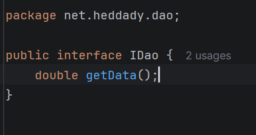
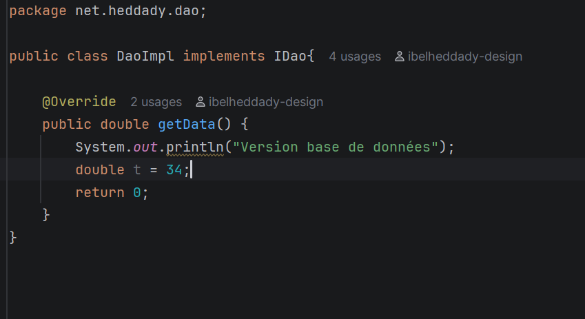
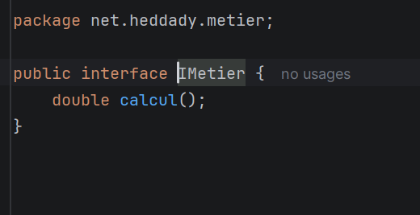
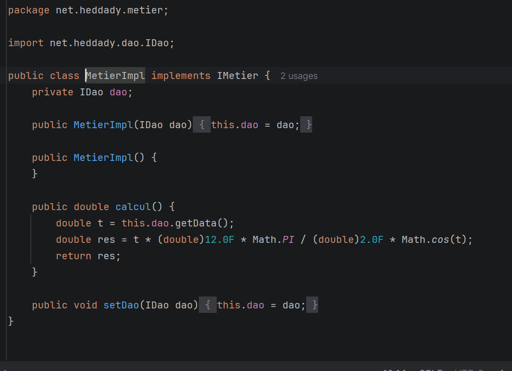
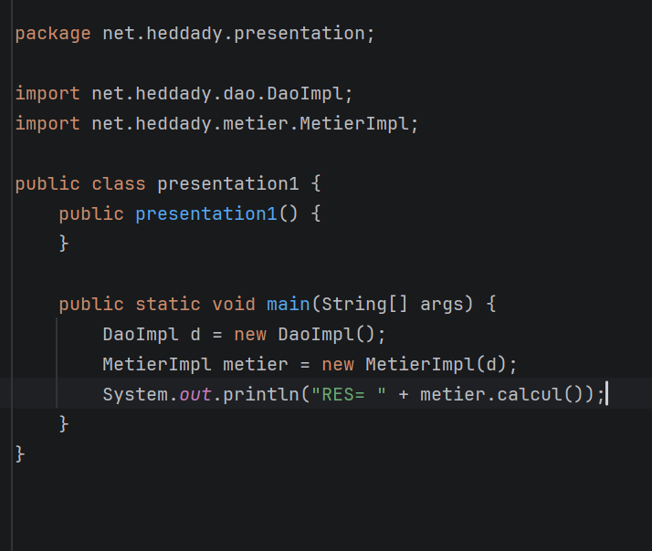
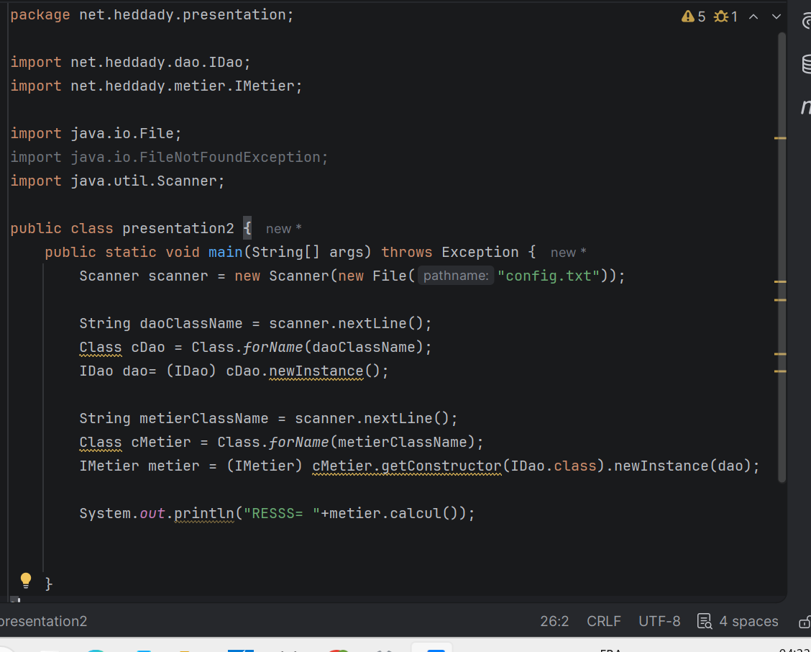
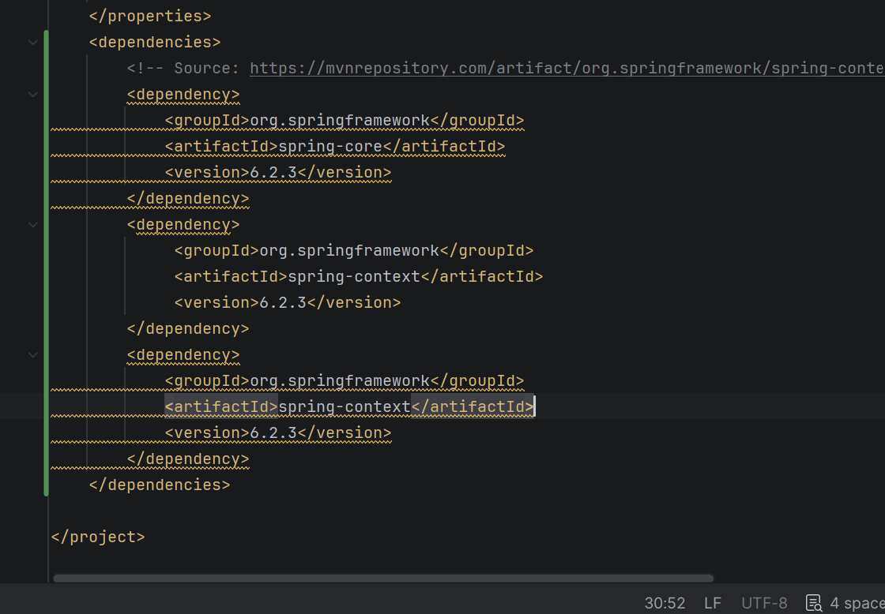
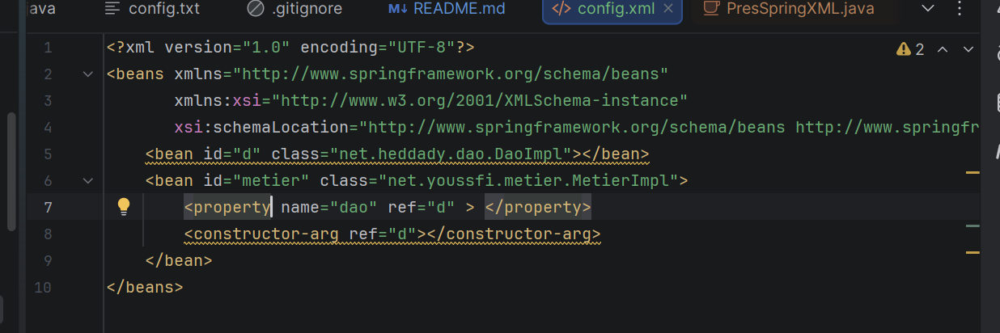
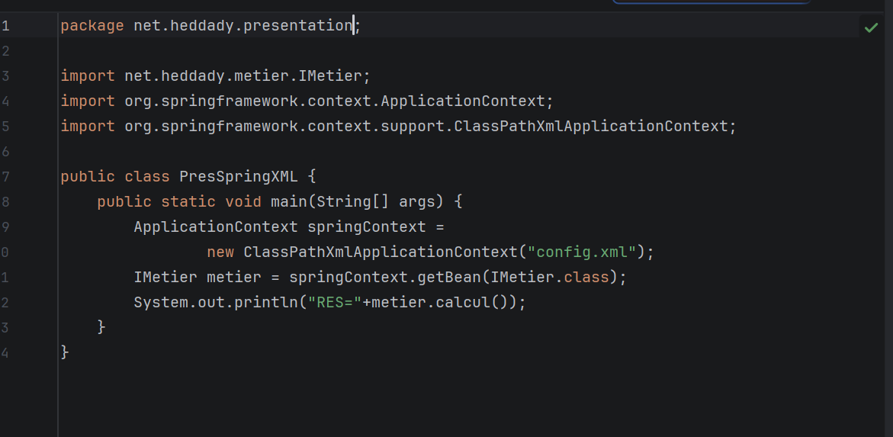

# tp-injection-dependances
TP injection de dépendances
Partie 1:
Création de l'interface IDao

La première étape consiste à créer une interface appelée IDao.

Cette interface définit une méthode getData() qui permet de récupérer une donnée.

L'utilisation d'une interface permet de séparer la définition du service de son implémentation.
Capture 1 : Structure du projet

Explication :

La méthode getData() représente le contrat que toutes les classes implémentant IDao doivent respecter.

Ainsi, la couche métier n'a pas besoin de connaître les détails de récupération des données.

4.2. Création de l'implémentation de IDao

Nous créons ensuite une classe DaoImpl qui implémente l'interface IDao.

}

Explication :

La classe DaoImpl fournit une implémentation concrète de la méthode getData().

Dans cet exemple, elle retourne une valeur numérique représentant une donnée récupérée. Dans une application réelle, cette méthode pourrait effectuer une consultation dans une base de données.

4.3. Création de l'interface IMetier

Nous créons une deuxième interface appelée IMetier.

Elle contient une méthode calcul() qui représente le traitement métier de l'application.

Explication :

L'interface IMetier définit le contrat de la couche métier sans imposer une manière particulière de réaliser le calcul.

4.4. Création de l'implémentation MetierImpl avec couplage faible

Nous créons la classe MetierImpl qui implémente l'interface IMetier.

Cette classe utilise une dépendance de type IDao.

Explication :

La classe MetierImpl dépend de l'interface IDao et non directement de la classe DaoImpl.

C'est ce qui permet d'obtenir un couplage faible.

L'utilisation de la méthode setDao() permet d'injecter une implémentation de IDao depuis l'extérieur.

Cette approche facilite le remplacement de l'implémentation DAO sans modifier le code de la classe métier.
Partie 2:
-Injection par instanciation statique

Dans cette première méthode, les objets sont créés directement dans la classe principale.

Explication :

Nous créons une instance de DaoImpl.

Nous créons une instance de MetierImpl.

Nous injectons l'objet DAO dans l'objet métier à l'aide de setDao().

Nous exécutons la méthode calcul().

Cette méthode est appelée statique parce que les classes concrètes sont directement instanciées dans le code source.

Avantage : elle est simple à mettre en place.

Inconvénient : le changement d'implémentation nécessite une modification du code source.
Partie 3:
-Injection par instanciation dynamique
Dans cette deuxième méthode, nous utilisons la réflexion Java pour charger dynamiquement les classes à partir d'un fichier de configuration.

Le fichier config.txt contient les noms des classes à instancier :

dao.DaoImpl
metier.MetierImpl

Explication :

Cette méthode utilise principalement :

Scanner pour lire le fichier de configuration.

Class.forName() pour charger une classe à partir de son nom.

getDeclaredConstructor().newInstance() pour créer dynamiquement une instance.

getMethod() et invoke() pour appeler la méthode d'injection.

L'avantage de cette approche est qu'il est possible de changer les classes utilisées en modifiant uniquement le fichier config.txt, sans modifier la classe principale, à condition de respecter les interfaces et les méthodes attendues.

Partie 4:
-Création des dépendances

-Injection avec Spring XML

Pour cette méthode, nous déclarons les objets et leurs dépendances dans un fichier XML.

Exemple de configuration config.xml :

La classe principale utilise ensuite le conteneur Spring :

Explication :

Le bean dao représente l'objet DAO.

Le bean metier représente l'objet métier.

La propriété dao permet d'injecter la dépendance DAO dans l'objet métier.

ApplicationContext représente le conteneur Spring.

getBean() permet de récupérer un objet géré par Spring.

L'avantage de cette méthode est que la configuration des dépendances est séparée du code Java.

Partie 4 
-Injection avec Spring et les annotations
package dao;

import org.springframework.stereotype.Component;

@Component("dao")
public class DaoImpl implements IDao {

    @Override
    public double getData() {
        System.out.println("Version base de données");
        return 23;
    }
}

Ensuite, nous ajoutons les annotations nécessaires dans la classe MetierImpl :

package metier;

import dao.IDao;
import org.springframework.beans.factory.annotation.Autowired;
import org.springframework.stereotype.Service;

@Service("metier")
public class MetierImpl implements IMetier {

    @Autowired
    private IDao dao;

    @Override
    public double calcul() {
        return dao.getData() * 2;
    }
}

Enfin, nous activons la détection automatique des composants dans la configuration Spring.

Exemple avec une classe de configuration :

import org.springframework.context.annotation.ComponentScan;
import org.springframework.context.annotation.Configuration;

@Configuration
@ComponentScan(basePackages = {"dao", "metier"})
public class SpringConfig {
}

La classe principale devient :

import org.springframework.context.ApplicationContext;
import org.springframework.context.annotation.AnnotationConfigApplicationContext;
import metier.IMetier;

public class PresentationSpringAnnotations {

    public static void main(String[] args) {

        ApplicationContext context =
            new AnnotationConfigApplicationContext(SpringConfig.class);

        IMetier metier = context.getBean(IMetier.class);

        System.out.println("Résultat = " + metier.calcul());
    }
}

Explication des annotations :

@Component : indique à Spring qu'une classe est un composant à gérer.

@Service : indique que la classe appartient à la couche métier.

@Autowired : demande à Spring d'injecter automatiquement la dépendance.

@Configuration : indique une classe de configuration Spring.

@ComponentScan : permet de rechercher automatiquement les composants dans les packages indiqués.